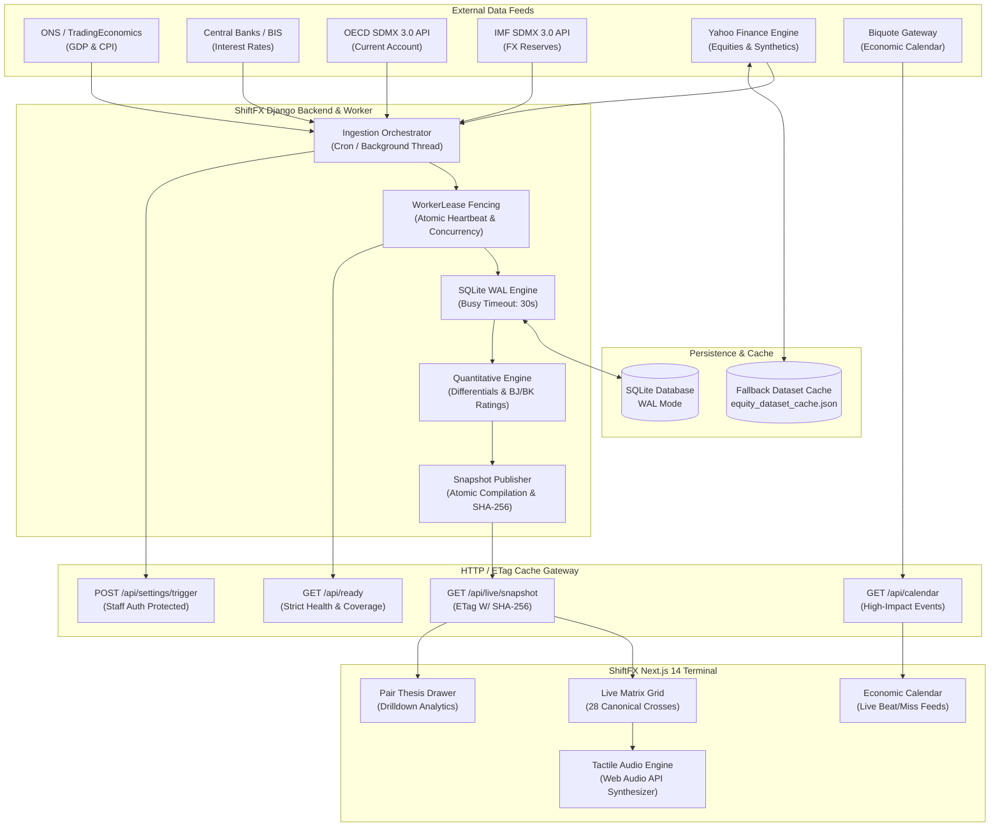
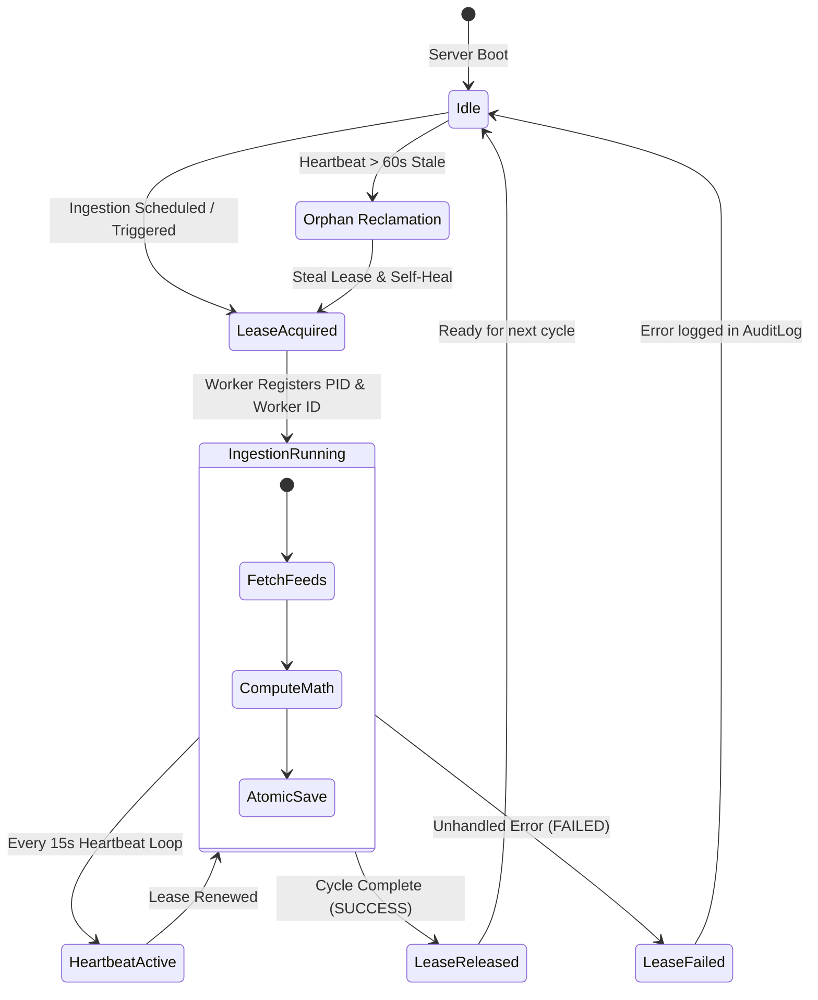
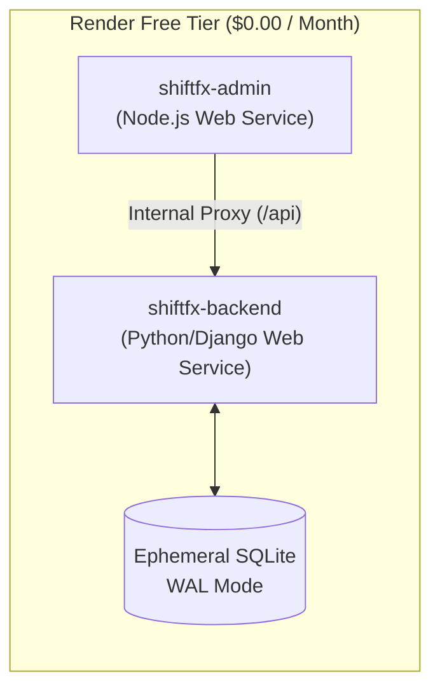

<div align="center">


# ShiftFX — Institutional FX Macro Bias Engine & Terminal

**Autonomous Quantitative Currency Matrix, Multi-Source Macroeconomic Pipeline & Institutional Terminal**

[](https://nextjs.org/)
[](https://www.djangoproject.com/)
[](https://python.org)
[](https://www.typescriptlang.org/)
[](https://tailwindcss.com/)
[](https://render.com)
[](https://github.com/KaidAkram/FOREX)
[](LICENSE)

<br/>

[Live Terminal](https://shiftfx-admin.onrender.com) • [API Endpoint](https://shiftfx-backend.onrender.com/api/live/snapshot) • [System Readiness](https://shiftfx-backend.onrender.com/api/ready) • [Architecture](#system-architecture) • [Mathematical Model](#quantitative-mathematical-formulation) • [Quickstart](#local-development-quickstart)

</div>

---

## 📑 Table of Contents

- [Executive Overview](#executive-overview)
- [Key Features](#key-features)
- [System Architecture](#system-architecture)
  - [End-to-End Data Pipeline](#end-to-end-data-pipeline)
  - [Distributed Fencing & Worker Lease Engine](#distributed-fencing--worker-lease-engine)
- [Quantitative Mathematical Formulation](#quantitative-mathematical-formulation)
  - [1. Equity Differential Engine (Synthetic vs Index ATH)](#1-equity-differential-engine-synthetic-vs-index-ath)
  - [2. Macroeconomic Indicator Differentials](#2-macroeconomic-indicator-differentials)
  - [3. Discrete Rating Mapping (BJ & BK Grids)](#3-discrete-rating-mapping-bj--bk-grids)
  - [4. Composite Score & Bias Regime Classification](#4-composite-score--bias-regime-classification)
- [Coverage Universe & Macro Indicators](#coverage-universe--macro-indicators)
- [Economic Calendar Subsystem](#economic-calendar-subsystem)
- [REST API Reference & ETag Protocol](#rest-api-reference--etag-protocol)
- [Repository Structure](#repository-structure)
- [Local Development Quickstart](#local-development-quickstart)
- [Comprehensive Verification & Testing Suite](#comprehensive-verification--testing-suite)
- [Production Deployment (Render Zero-Cost Topology)](#production-deployment-render-zero-cost-topology)
- [Security & Governance](#security--governance)
- [License](#license)

---

## 🏛 Executive Overview

**ShiftFX** is an institutional-grade macroeconomic forecasting and quantitative currency scoring terminal designed to identify asymmetric currency trends across the **G10 currency universe** (USD, EUR, GBP, JPY, AUD, CAD, CHF, NZD, SEK, NOK) across **28 canonical currency crosses** plus synthetic benchmark indices.

By continuously aggregating raw time-series data from national statistical institutes, supranational central banks (IMF, OECD), and live market feeds (Yahoo Finance, Biquote), ShiftFX translates disparate macroeconomic releases into actionable, standardized cross-currency bias scores $[-10, +10]$.

```
+---------------------------------------------------------------------------------------------------+
|                                      SHIFTFX SYSTEM WORKFLOW                                      |
|                                                                                                   |
|  [Official APIs]  -->  [Worker Fencing]  -->  [Quantitative Core]  -->  [Atomic Snapshot]  --> [Next.js Terminal]  |
|  IMF, OECD, ONS,       WorkerLease             Diffs & Ratings          ETag SHA-256           28 Crosses Grid    |
|  Yahoo, Biquote        WAL Concurrency         [-10, +10] Scores        HTTP 304 Cache         Tactile Audio UI   |
+---------------------------------------------------------------------------------------------------+
```

---

## ⚡ Key Features

- **Autonomous Multi-Source Ingestion**: Ingests GDP, CPI, Central Bank Policy Rates, Current Account balances, IMF FX Reserves, and Equity Market indices automatically with zero manual intervention.
- **Strict Concurrency & Fencing Protection**: Implements database-level `WorkerLease` fencing with atomic heartbeats, active lease validation, and automated reclamation of orphaned leases ($>60\text{s}$).
- **Anti-Regression Data Protection**: Dynamic engine caches provider datasets locally with cryptographic provenance validation, preventing transient provider rate limits from regressing newer live observations.
- **Deterministic Mathematical Scoring**: Translates raw macroeconomic spreads into normalized discrete ratings using institutional matrix grids (`BJ_GRID` & `BK_GRID`) and synthetic equity ATH spread mechanics.
- **Atomic Serialization & ETag Cache**: Exposes compiled macro snapshots (`/api/live/snapshot`) validated with weak (`W/`) and strong SHA-256 ETags supporting HTTP 304 conditional request short-circuiting.
- **Real-Time Economic Calendar**: Aggregates high-impact macroeconomic calendar events from Biquote with automated country-matching, beat/miss delta calculations, and upcoming event filters.
- **Wall Street Terminal UI**: Dark-mode glassmorphic dashboard built in Next.js 14 and Tailwind CSS featuring dynamic relative strength barometers, pair thesis slide-out drawers, and tactile Web Audio FX.

---

## 🏗 System Architecture

### End-to-End Data Pipeline

ShiftFX operates as a decoupled microservices architecture with a dedicated ingestion engine, an analytical calculation core, an atomic caching layer, and a client-facing Next.js terminal.



### Distributed Fencing & Worker Lease Engine

To guarantee zero database lock collisions on SQLite and eliminate split-brain execution across web threads, background workers, and staff triggers, ShiftFX enforces mutual exclusion via `WorkerLease`:



---

## 🧮 Quantitative Mathematical Formulation

The core analytical pipeline synthesizes macroeconomic data into directional currency bias through a 4-step quantitative methodology.

### 1. Equity Differential Engine (Synthetic vs Index ATH)

For every canonical pair $A/B$ (e.g., `EUR/USD`), the relative equity impulse is evaluated against the all-time high (ATH) of both the benchmark equity index and the synthetic cross-currency equity pair.

Let $ATH^{\text{green}}$ denote the highest closing level prior to the active evaluation window:

$$\Delta_{\text{Index}} = \frac{\text{Close}_{\text{Index}} - ATH_{\text{Index}}^{\text{green}}}{ATH_{\text{Index}}^{\text{green}}}$$

$$\Delta_{\text{Synth}} = \frac{\text{Close}_{\text{Synth}} - ATH_{\text{Synth}}^{\text{green}}}{ATH_{\text{Synth}}^{\text{green}}}$$

The raw equity differential is defined strictly as **Synthetic change minus Index change**:

$$\text{Differential}_{\text{Equity}} = \Delta_{\text{Synth}} - \Delta_{\text{Index}}$$

> [!NOTE]
> When $\Delta_{\text{Synth}} > \Delta_{\text{Index}}$, the cross currency has outperformed its domestic stock benchmark, indicating relative capital inflow and generating a bullish equity differential for the base currency.

### 2. Macroeconomic Indicator Differentials

For all standard economic indicators (GDP, CPI, Interest Rate, Current Account, FX Reserves), the spread between base economy $A$ and quote economy $B$ is calculated as:

$$\text{Differential}_{k} = \text{Value}_{A, k} - \text{Value}_{B, k}$$

Where $k \in \{\text{GDP}, \text{CPI}, \text{IR}, \text{CA}, \text{FXR}\}$.

### 3. Discrete Rating Mapping (BJ & BK Grids)

Raw continuous differentials are mapped into discrete institutional rating grades $[-10, +10]$ using calibrated indicator step grids (`BJ_GRID` and `BK_GRID`):

| Rating | GDP Spread (%) | CPI Spread (%) | IR Spread (%) | Current Account (%) | Equity Diff (%) |
|:---:|:---:|:---:|:---:|:---:|:---:|
| **+10** | $\ge +2.50$ | $\ge +2.00$ | $\ge +2.00$ | $\ge +5.00$ | $\ge +10.0$ |
| **+7** | $+1.50 \dots +2.49$ | $+1.25 \dots +1.99$ | $+1.25 \dots +1.99$ | $+3.00 \dots +4.99$ | $+6.0 \dots +9.9$ |
| **+5** | $+0.75 \dots +1.49$ | $+0.75 \dots +1.24$ | $+0.75 \dots +1.24$ | $+1.50 \dots +2.99$ | $+3.0 \dots +5.9$ |
| **+2** | $+0.25 \dots +0.74$ | $+0.25 \dots +0.74$ | $+0.25 \dots +0.74$ | $+0.50 \dots +1.49$ | $+1.0 \dots +2.9$ |
| **0** | $-0.24 \dots +0.24$ | $-0.24 \dots +0.24$ | $-0.24 \dots +0.24$ | $-0.49 \dots +0.49$ | $-0.9 \dots +0.9$ |
| **-2** | $-0.74 \dots -0.25$ | $-0.74 \dots -0.25$ | $-0.74 \dots -0.25$ | $-1.49 \dots -0.50$ | $-2.9 \dots -1.0$ |
| **-5** | $-1.49 \dots -0.75$ | $-1.24 \dots -0.75$ | $-1.24 \dots -0.75$ | $-2.99 \dots -1.50$ | $-5.9 \dots -3.0$ |
| **-7** | $-2.49 \dots -1.50$ | $-1.99 \dots -1.25$ | $-1.99 \dots -1.25$ | $-4.99 \dots -3.00$ | $-9.9 \dots -6.0$ |
| **-10** | $\le -2.50$ | $\le -2.00$ | $\le -2.00$ | $\le -5.00$ | $\le -10.0$ |

### 4. Composite Score & Bias Regime Classification

The final composite pair score is computed by weighted summation of discrete indicator ratings:

$$\text{Final Score} = \sum_{i=1}^{N} w_i \cdot \text{Rating}_i, \quad \sum w_i = 1.0$$

The resultant score is classified into five operational trading regimes:

```
[-10] ================= [-6] ============== [-2] ====== [0] ====== [+2] ============== [+6] ================= [+10]
          STRONG BEARISH             BEARISH             NEUTRAL             BULLISH             STRONG BULLISH
          (Heavy Short)           (Lean Short)       (Range / Flat)        (Lean Long)            (Heavy Long)
```

---

## 🌐 Coverage Universe & Macro Indicators

ShiftFX monitors the **10 G10 economies** covering all **28 canonical crosses**:

| Code | Currency | Country / Region | Central Bank | Benchmark Equity Index |
|:---:|:---:|:---:|:---:|:---:|
| **USD** | US Dollar | United States | Federal Reserve (Fed) | S&P 500 (`^GSPC`) |
| **EUR** | Euro | Euro Area | European Central Bank (ECB) | EURO STOXX 50 (`^STOXX50E`) |
| **GBP** | British Pound | United Kingdom | Bank of England (BoE) | FTSE 100 (`^FTSE`) |
| **JPY** | Japanese Yen | Japan | Bank of Japan (BoJ) | Nikkei 225 (`^N225`) |
| **AUD** | Australian Dollar | Australia | Reserve Bank of Australia (RBA) | S&P/ASX 200 (`^AXJO`) |
| **CAD** | Canadian Dollar | Canada | Bank of Canada (BoC) | S&P/TSX Composite (`^GSPTSE`) |
| **CHF** | Swiss Franc | Switzerland | Swiss National Bank (SNB) | Swiss Market Index (`^SSMI`) |
| **NZD** | New Zealand Dollar | New Zealand | Reserve Bank of New Zealand (RBNZ) | S&P/NZX 50 (`^NZ50`) |
| **SEK** | Swedish Krona | Sweden | Sveriges Riksbank | OMX Stockholm 30 (`^OMX`) |
| **NOK** | Norwegian Krone | Norway | Norges Bank | Oslo OBX (`OBX.OL`) |

### Indicator Pipeline Specifications

```
Indicator          Frequency    Primary Source          Secondary / Fallback      Methodology
------------------------------------------------------------------------------------------------------
GDP YoY            Quarterly    National Accounts/ONS   TradingEconomics          Real GDP Growth YoY %
CPI YoY            Monthly      Bureau of Labor/Stats   TradingEconomics          Headline Inflation YoY %
Interest Rate      Continuous   Central Bank Releases   BIS / Public Feeds        Target Policy Rate %
Current Account    Quarterly    OECD SDMX 3.0 API       National Treasuries       BOP % of Nominal GDP
FX Reserves        Monthly      IMF SDMX 3.0 API        Official Central Banks    Total Reserves (USD M)
Equity ATH Spread  Daily        Yahoo Finance Market    Local Cache Bundle        Synthetic ATH Delta
```

---

## 📅 Economic Calendar Subsystem

The ShiftFX Economic Calendar aggregates macroeconomic releases directly through the Biquote feed and internal normalization engine:

- **11 Market Coverage**: Full coverage across US, UK, Euro Area, Japan, Australia, Canada, Switzerland, New Zealand, Sweden, Norway, and global supra-events.
- **Beat / Miss Classification**: Automatically compares `Actual` vs `Forecast` and `Previous` with colored visual impact cues.
- **Upcoming Events Filter**: Client and server routes filter upcoming events sorted chronologically to highlight imminent volatility events.
- **Deduplication Engine**: Cleanses, deduplicates, and validates incoming calendar payloads in under 5ms.

---

## 🔌 REST API Reference & ETag Protocol

All public endpoints support caching headers and sub-50ms serialized responses.

| Method | Endpoint | Auth | Description | Cache / ETag |
|:---:|:---|:---:|:---|:---:|
| `GET` | `/api/live/snapshot` | Public | Compiled macroeconomic snapshot (scores, indicators, ratings, coverage) | `W/"<sha256>"` (HTTP 304) |
| `GET` | `/api/ready` | Public | System readiness probe (worker status, strict indicator coverage) | No cache |
| `GET` | `/api/health` | Public | Server liveness probe (`{"status": "ok"}`) | No cache |
| `GET` | `/api/calendar` | Public | Full economic calendar feed (250+ events) | 60s cache |
| `GET` | `/api/calendar/upcoming` | Public | Chronologically sorted upcoming high-impact events | 60s cache |
| `GET` | `/api/settings` | Staff | Ingestion scheduler configuration & cron parameters | JWT / Session |
| `POST` | `/api/settings/trigger-scraper` | Staff | Trigger an immediate manual ingestion cycle | JWT / Session |

### Conditional Request Handling (HTTP 304)

```bash
# Initial request returns payload and ETag
curl -i https://shiftfx-backend.onrender.com/api/live/snapshot

# Subsequent request using ETag validator
curl -i -H 'If-None-Match: W/"3229b4b0eb10c59828e3b2e597cbb1156e1b744473859ea426f03d527ca07be5"' \
  https://shiftfx-backend.onrender.com/api/live/snapshot

# Response: HTTP/1.1 304 Not Modified (0 bytes transferred)
```

---

## 📁 Repository Structure

```
FOREX/
├── .gitignore                          # Strict ignore rules (cache, venv, secrets, logs)
├── logo.svg                            # ShiftFX Institutional Brand Mark
├── render.yaml                         # Render Cloud Infrastructure as Code Blueprint
├── equity_engine.py                    # Root Yahoo Finance synthetic calculation engine
├── imf_fx_reserves.py                  # Root IMF SDMX 3.0 FX Reserves extraction engine
├── equity_dataset_cache.json           # Offline fallback dataset bundle with provenance
│
├── fx-macro-bias/
│   ├── backend/                        # Django 5.2 / DRF Core Application
│   │   ├── apps/
│   │   │   ├── common/                 # Permissions, JWT security, middleware
│   │   │   └── macro/                  # Macro forecasting business logic
│   │   │       ├── management/         # Management commands (bootstrap, scrape, worker)
│   │   │       ├── migrations/         # Django schema migrations (0001 - 0004)
│   │   │       ├── models/             # Economy, Indicator, Observation, WorkerLease
│   │   │       ├── services/           # Ingestion, calculator, fencing, scheduler, snapshot
│   │   │       ├── tests/              # Django test suites (autonomous pipeline, equity)
│   │   │       └── views/              # Live API, calendar, final score, settings views
│   │   ├── config/                     # Settings (base, development, production)
│   │   ├── manage.py                   # Django CLI entrypoint
│   │   └── requirements.txt            # Python production dependencies
│   │
│   └── frontend/                       # Next.js 14 App Router Terminal UI
│       ├── public/                     # Static assets, SVG flags, audio FX
│       ├── src/
│       │   ├── app/                    # 19 static/dynamic route pages & layouts
│       │   ├── components/             # Glassmorphic UI components, charts, drawers
│       │   ├── context/                # Live data, authentication, language contexts
│       │   ├── lib/                    # API clients, ETag handlers, calendar utilities
│       │   └── store/                  # Zustand state management
│       ├── package.json                # Frontend scripts and dependencies
│       └── tailwind.config.ts          # Custom institutional dark-mode palette
│
├── memory/                             # Audit reports, production verification logs
├── scripts/                            # Operational verification & health scripts
└── tests/                              # Global test suites (Node tsx, Python unittest)
```

---

## 🚀 Local Development Quickstart

### Prerequisites

- **Node.js**: v18.0.0 or later
- **Python**: v3.11 or v3.12
- **Git**

### 1. Clone & Setup Backend

```bash
# Clone the repository
git clone https://github.com/KaidAkram/FOREX.git
cd FOREX

# Navigate to backend
cd fx-macro-bias/backend

# Install Python dependencies
pip install -r requirements.txt

# Run database migrations
python manage.py migrate

# Initialize reference dimensions (10 economies, 6 indicators, 28 crosses)
python manage.py bootstrap_macro

# Start the Django development server
python manage.py runserver 127.0.0.1:8000
```

### 2. Setup Frontend Terminal

```bash
# Open a new terminal and navigate to frontend
cd fx-macro-bias/frontend

# Install dependencies
npm install

# Start Next.js development server
npm run dev
```

Visit **http://localhost:3000** to interact with the ShiftFX Terminal.

---

## 🧪 Comprehensive Verification & Testing Suite

ShiftFX features an exhaustive 4-tier verification suite covering all frontend, backend, engine, and build components:

```
====================================================================================================
SUITE                               FILES & SCOPE                             TEST COUNT    STATUS
====================================================================================================
1. Node Calendar & UI Test Suite    tests/biquote_calendar.test.ts            12 Tests      PASSED (100%)
                                    tests/fx_and_equity_frontend.test.ts
2. Python Root Engine Suite         tests/test_equity_engine.py               12 Tests      PASSED (100%)
                                    tests/test_imf_fx_reserves.py
3. Django Pipeline & Fencing Suite  apps/macro/tests/test_autonomous_pipeline.py 27 Tests   PASSED (100%)
                                    apps/macro/tests/test_fx_and_equity.py
4. Next.js Production Build         fx-macro-bias/frontend (next build)       19/19 Routes  PASSED (100%)
====================================================================================================
TOTAL TESTS: 51 / 51 PASSED (0 FAILURES)
====================================================================================================
```

### Execute Test Suites Locally

```bash
# 1. Run Node.js Tests
npx tsx --test tests/biquote_calendar.test.ts tests/fx_and_equity_frontend.test.ts

# 2. Run Python Engine Tests
python -m unittest tests/test_equity_engine.py tests/test_imf_fx_reserves.py

# 3. Run Django Test Suite
cd fx-macro-bias/backend
python manage.py test apps.macro.tests
cd ../..

# 4. Verify Frontend Production Build
cd fx-macro-bias/frontend
npm run build
cd ../..
```

---

## ☁️ Production Deployment (Render Zero-Cost Topology)

ShiftFX is pre-configured for automated continuous deployment using Render Blueprints (`render.yaml`).

### Zero-Cost Free Plan Architecture



> [!IMPORTANT]
> **Free Tier Lifecycle Note**:
> Render Free web instances enter sleep mode after 15 minutes of inactivity. When a request arrives, the instance performs a cold start within 45–55 seconds. SQLite data is ephemeral across service redeploys; on boot, `python manage.py bootstrap_macro --continuous` runs automatically to immediately re-initialize canonical dimensions, start the continuous worker loop, and regenerate live snapshots.

### Upgrading to Always-On Institutional Tier

For uninterrupted 24/7 background ingestion and zero cold starts, transition to Render's paid tier:
1. Upgrade `shiftfx-backend` and `shiftfx-admin` from `plan: free` to `plan: starter` ($7/mo).
2. Provision a persistent PostgreSQL database (`render.com/docs/databases`).
3. Set `DATABASE_URL` in environment variables.

---

## 🔒 Security & Governance

- **Authentication**: JWT token-based authentication via `djangorestframework-simplejwt` with automatic token refresh and blacklisting.
- **Role-Based Access Control (RBAC)**: All administrative triggers, settings mutations, and manual overrides require authenticated staff/superuser credentials.
- **Audit Logging**: Every automated and manual ingestion cycle logs timestamped execution telemetry, affected rows, status codes, and errors to `AuditLog`.
- **Environment Isolation**: Production secrets, database credentials, and API keys are strictly decoupled via environment variables.

---

## 📄 License

ShiftFX is open-source software licensed under the **[MIT License](LICENSE)**.

<div align="center">
<sub>Built with precision for quantitative currency analysts, macro strategists, and foreign exchange traders.</sub>
</div>
